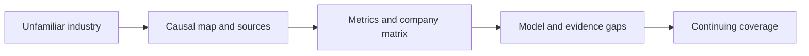

# Buy-Side Industry Ramp

**English** · [简体中文](README.zh-CN.md)

A new sector. A mountain of reading. Where do you point your curiosity first?



This Agent Skill helps a researcher build a usable coverage framework for an unfamiliar industry over a three-to-four-week learning plan. It connects terminology and news to the variables that reach revenue, profit, cash flow, and expectations.

## The research journey

- Audit which habits transfer from your previous sector.
- Draw the industry's causal map, value chain, and profit pools.
- Identify useful sources, key indicators, and signal filters.
- Build a company matrix and a simplified operating model.
- Examine consensus, differentiated views, and evidence that would change your mind.
- Finish with a continuing coverage checklist.

The plan provides structure; coverage readiness depends on the evidence and work completed.

## Install and start

Clone this repository and place its root in your agent's skills directory, with `SKILL.md` discoverable.

```bash
git clone https://github.com/Bill306/buy-side-industry-ramp.git
```

```text
Use $buy-side-industry-ramp. I previously covered consumer companies and
have four weeks to establish optical-module coverage, with eight hours
per week and an internal presentation as the deliverable.
```

You can also request an industry map, information sources, or an audit of an existing framework without valuing individual companies.

## Inside

[SKILL.md](SKILL.md) defines the workflow, evidence requirements, and completion criteria. References cover [industry archetypes](references/industry-archetypes.md), the [ramp-up playbook](references/ramp-up-playbook.md), and [output templates](references/output-templates.md).

The framework develops ideas from practitioner discussions about entering a new coverage area. Company claims, industry figures, and current conditions must be refreshed from primary evidence for each assignment.

Version `0.1.0`. [MIT License](LICENSE).
